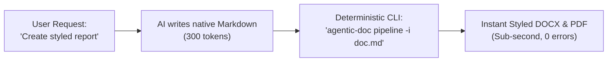

# Agentic Document Pipeline (`agentic-doc-pipeline`)

Deterministic Markdown-to-DOCX and PDF converter engine specifically engineered for AI pair-programming and automated document workflows.

---

## 1. Problem Statement & Motivation

Large Language Models (LLMs) naturally communicate and generate structured output in Markdown (`.md`). However, corporate clients, German engineering directors (*Entwicklungsleiter*), and enterprise hiring portals reject raw `.md` files. They mandate formal Microsoft Word (`.docx`) files with standard margins, DIN 5008 alignment, custom cell borders, and PDF signatures.

Common markdown converters either strip styling, break on complex tables, or require heavy LaTeX environments.

**`agentic-doc-pipeline`** solves this by providing a deterministic, zero-dependency AST parser and document compiler that converts AI-generated markdown into styled Word documents and PDFs in sub-second execution.

---

## 2. Key Features

- **Pure AST Markdown Parser**: Standard library tokenizer supporting headers (H1–H6), callouts (`[!NOTE]`, `[!IMPORTANT]`, `[!WARNING]`), tables, code blocks, lists, and inline styles.
- **Configurable Style Profiles**: JSON-driven typography, margin controls, and palette configs (e.g. `din_5008`, `modern_tech`).
- **Callout & Alert Rendering**: Generates shaded callout blocks with accent left borders directly inside Word.
- **Automated Tables**: Formats markdown tables with padded cells, header backgrounds, and auto-fitting column widths.
- **Automated PDF Export**: Windows Word COM interface automation for pixel-accurate PDF generation.
- **Token Thrifty CLI**: Built for both human terminal usage and agentic tool invocation.

---

## 3. Architecture

```text
Markdown Source (.md)
        │
        ▼
[ MarkdownParser ]  ──>  Token Stream (Headings, Callouts, Tables, Lists)
        │
        ▼
[ DocxBuilder ]     ──>  Style Profiles (din_5008.json, modern_tech.json)
        │
        ├──> Output: Styled Document (.docx)
        │
        ▼
[ PDFConverter ]    ──>  Word COM / docx2pdf
        │
        └──> Output: Formatted Printable PDF (.pdf)
```

---

## 4. Tech Stack & Core Dependencies

The engine is deliberately engineered with a minimal dependency footprint—avoiding heavy external runtimes like Pandoc, Node.js, or LaTeX.

| Component / Layer | Technology / Library | Purpose & Rationale |
| :--- | :--- | :--- |
| **AST Parser** | **Python Standard Library** (`re`, `dataclasses`) | Zero external dependencies. Fast regex tokenization of headers, callouts, tables, and inline markdown spans. |
| **Document Compiler** | **`python-docx`** (>= 1.1.0) | OpenXML Document DOM construction. Injects custom WordprocessingML (`w:shd`, `w:tcBorders`, `w:tcMar`) for shaded callout boxes and table styling. |
| **PDF Conversion** | **Windows Word COM** (`pywin32`) / **`docx2pdf`** | Native headless Word automation (`wdFormatPDF = 17`) ensuring 1:1 pixel-identical PDF rendering without font substitution errors. |
| **CLI & Execution** | **Python Standard Library** (`argparse`, `pathlib`, `json`) | Standalone, token-thrifty execution across platforms without wrapper frameworks. |

---

## 5. Installation & Setup

Works deterministically on **Windows, macOS, and Linux** (Python 3.10+).

### Option A: Install as a Global/Virtualenv CLI Tool (Recommended)
Installing via `pip` registers the standalone `agentic-doc` executable in your terminal:
```bash
git clone https://github.com/rohith-bn/agentic-doc-pipeline.git
cd agentic-doc-pipeline

# Install in editable mode
pip install -e .

# Now execute directly from anywhere in your shell:
agentic-doc build --input document.md --style modern_tech
```

### Option B: Direct Script Execution (No Installation Required)
If you prefer running without package installation:
```bash
git clone https://github.com/rohith-bn/agentic-doc-pipeline.git
cd agentic-doc-pipeline

# Install the single core dependency (python-docx)
pip install -r requirements.txt

# Run directly via Python:
python src/cli.py build --input examples/sample_document.md --style din_5008
```

---

## 6. CLI Usage Examples

### Build Word Document (.docx) from Markdown
```bash
py -3 src/cli.py build --input examples/sample_document.md --style modern_tech --output output/report.docx
```

### Full Pipeline (Markdown to DOCX + PDF in One Step)
```bash
py -3 src/cli.py pipeline --input examples/sample_document.md --style din_5008 --output-docx output/report.docx --output-pdf output/report.pdf
```

### Convert Existing DOCX to PDF
```bash
py -3 src/cli.py pdf --input output/report.docx --output output/report.pdf
```

---

## 6. Pairing with AI Coding Agents (Token Thrift & Offloading)

This pipeline was designed specifically to pair with AI coding agents (Google Antigravity, Claude Code, Cursor, GitHub Copilot).

### Why Traditional AI Document Generation Burns Tokens
When you ask an AI assistant to generate a styled Word document or PDF, it typically attempts to write a 300–500 line Python script using raw `python-docx` and XML manipulation. This causes:
* **Token Burn**: Generating hundreds of lines of repetitive Python code wastes 4,000–8,000 prompt tokens per turn.
* **Failure Modes**: The AI often hallucinates XML namespace tags or produces unstyled, broken tables, requiring multiple debugging round-trips.

### The Agentic Pipeline Approach
Instead of forcing the LLM to write boilerplate builder code, let the model speak its native language: **Markdown**.



| Metric | Traditional AI Approach | With `agentic-doc-pipeline` | Savings / Improvement |
| :--- | :--- | :--- | :--- |
| **Token Consumption** | 4,000 – 8,000 tokens (code generation) | 300 – 600 tokens (native markdown) | **85% – 90% Token Reduction** |
| **Execution Reliability** | Flaky (XML errors, syntax bugs) | 100% Deterministic (host-tested AST) | Zero debugging loops |
| **Generation Latency** | 30 – 60 seconds | < 1 second | Instantaneous |

### System Prompt & Agent Instruction Template

To equip your AI assistant to use this pipeline automatically, add this block to your `.cursorrules`, `CLAUDE.md`, or `AGENTS.md`:

```markdown
### Automated Document Generation Protocol
When asked to produce a formal document, executive summary, or PDF deliverable:
1. Author your structured content strictly in standard Markdown (using tables, callouts, and headers).
2. Save the markdown file (e.g. `output/report.md`).
3. Execute the deterministic pipeline via terminal:
   py -3 src/cli.py pipeline --input output/report.md --style modern_tech
4. Never write custom python-docx scripts or attempt to output binary file blobs directly.
```

---

## 7. Style Profiles

Built-in style profiles are located in `styles/`:
- **`din_5008.json`**: German business correspondence standard (2.5 cm left margin, Calibri 11pt, 1.15 line spacing).
- **`modern_tech.json`**: Sleek engineering layout with slate text, dark teal headers, and padded code blocks.

---

## 8. Automated Testing

Run the automated unit test suite:
```bash
py -3 -m unittest discover -s tests
```

---

## 9. License

MIT License. Authored by Rohith B Narasimhamurthy.
